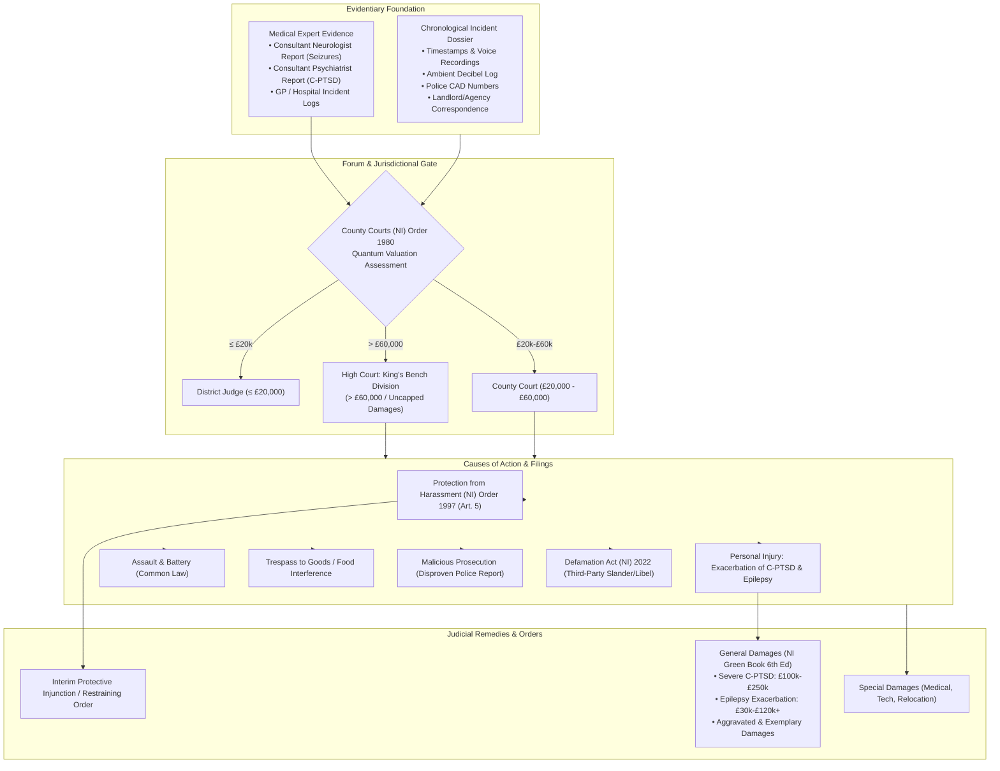

# CIANDLITHE Case Study — Bangor / Belfast Shared Tenancy Harassment, Malicious Reporting & Neurological Exacerbation (November 2026 Incident)

> **Classification:** BLIP v1 Cohort `TenancyHarassment` | Jurisdiction: Northern Ireland (`NI`) | Sub-Region: Bangor / Greater Belfast, County Down / Antrim (November 2026 Incident)  
> **Applicable Forums:** High Court of Justice in Northern Ireland (King's Bench Division, Royal Courts of Justice, Belfast) / County Court (Northern Ireland) / Police Service of Northern Ireland (PSNI) / Public Prosecution Service Northern Ireland (PPS NI) / Legal Services Agency Northern Ireland (LSANI)  
> **Source Documents (Read-Only Context):** [`bangor.md`](file:///Users/cianmacandeisigh/dev/ciandlithe/bangor.md) (Context & Statutory Authority Matrix), Ards and North Down Borough Council / Belfast City Council Environmental Health Regulations, Judicial Studies Board Northern Ireland *Green Book* (6th Edition), DoJ NI & PPS NI Prosecution Guidelines  
> **Compliance Enforcements:** `osint_ceiling_enforced = True` (`LICENSE.md §5.1`) | `analyst_review_required = True` (`LICENSE.md §5.2` & `§3.8`) | No Automated Form Submission  

---

## 1. Executive Summary & Factual Matrix

This case study establishes the canonical legal analysis, evidentiary architecture, and multi-track operational roadmap for resolving a targeted domestic harassment campaign against a singular male occupant living in a private bedroom within a shared tenancy / House in Multiple Occupation (HMO) setting in **Bangor / Greater Belfast, Northern Ireland (November 2026 Incident)** (under the territorial jurisdiction of the Ards and North Down Borough Council / Belfast City Council, the Northern Ireland Courts and Tribunals Service, and the Police Service of Northern Ireland).

### 1.1 Factual Background
* **Premises & Tenancy Status:** The occupant holds lawful, exclusive possession of a private bedroom within a shared residential co-tenancy / HMO. 
* **Targeted Domestic Activities:** Normal speaking-volume vocalization within the occupant's private room. Specific activities include:
  1. Real-time voice communications over online services and MMO gaming (e.g., *World of Warcraft*);
  2. Dictation via speech-to-text software as an auxiliary aid;
  3. Conversational interaction with artificial intelligence assistant interfaces;
  4. Reading academic research, legal documentation, and study materials aloud.
* **Timing & Frequency:** Occurring across day, evening, and night hours.
* **Perpetrator Conduct:** A co-tenant engages in an escalating, multi-incident course of conduct comprising:
  1. Direct physical assault and battery within common areas;
  2. Interference with personal consumables and food tampering (administering noxious substances / criminal damage);
  3. Lodging disproven, malicious police complaints to the PSNI;
  4. Shifting to petty, manufactured regulatory complaints regarding ordinary speaking-volume bedroom vocalization to the landlord, letting agent, and local authority, weaponizing the absence of continuous indoor decibel monitoring equipment;
  5. Inverting victim and offender status (DARVO tactics) to portray themselves as the aggrieved party.
* **Occupant Vulnerabilities:** The targeted occupant suffers from medically validated, pre-existing neurological and psychological conditions:
  - Severe Complex Post-Traumatic Stress Disorder (C-PTSD);
  - Cognitive reflex epilepsy and neuro-sensory hyperarousal, wherein sustained psychological distress, coercive hostility, and sleep disruption substantially lower the cortical seizure threshold, triggering acute myoclonic and reflex seizures.

---

## 2. Common Law, Human Rights & Acoustic Foundations

### 2.1 The Inherent Common Law Right to Domestic Speech
Under the laws of Northern Ireland, England and Wales, and the Republic of Ireland, an adult speaking at an unamplified, normal conversational register inside their private residence requires no statutory permission or housemate consent. The right to domestic vocalization is rooted in centuries of binding common law:

1. ***Semayne's Case* (1604) 5 Co Rep 91a:** Established the foundational constitutional doctrine of the inviolability and sanctity of the dwelling: *"the house of every one is to him as his castle and fortress, as well for his defence against injury and violence, as for his repose."*
2. ***Bamford v Turnley* (1862) 3 B&S 66:** Formulated the rule of mutual give-and-take in property law. Baron Bramwell held that acts necessary for the *"common and ordinary use and occupation of land and houses"* cannot constitute an actionable private nuisance, regardless of the time of day.
3. ***Southwark London Borough Council v Mills* / *Baxter v Camden LBC* [1999] 4 All ER 449, [2001] 1 AC 1 (House of Lords):** The binding landmark precedent across British jurisdictions. The House of Lords definitively established that:
   - The ordinary, natural, and reasonable domestic use of residential premises—which explicitly includes normal conversation, walking across floors, and day-to-day household sounds—can **never** constitute an actionable nuisance in tort.
   - Such ordinary domestic living sounds can **never** breach a landlord's covenant for quiet enjoyment.
   - This holds true even where structural soundproofing or party wall insulation between rooms or dwellings is poor or substandard, allowing ordinary speech to be faintly audible to neighbours or housemates.

### 2.2 Constitutional & International Human Rights Standards
* **European Convention on Human Rights (ECHR) / Human Rights Act 1998:**
  - **Article 8 (Right to Respect for Private and Family Life and Home):** Protects an individual's psychological integrity, personal autonomy, and peaceful enjoyment of their private bedroom free from intrusive harassment or coercive surveillance by co-occupants.
  - **Article 10 (Freedom of Expression):** Encompasses the freedom to speak, vocalize, study, and impart information via digital communications, voice chats, or assistive technologies.
* **Republic of Ireland Constitutional Concordance:** In *Bunreacht na hÉireann*, these protections are mirrored under **Article 40.5** (inviolability of the dwelling) and **Article 40.6.1°** (guarantee of freedom of expression).

### 2.3 Auxiliary Aids & Disability Protections
Where domestic vocalization involves dictation or reading aloud by an individual suffering from cognitive, sensory, or neurological impairments, such activities constitute protected **auxiliary aids** and **reasonable adjustments**:
* **Northern Ireland:** Under the *Disability Discrimination Act 1995* (DDA 1995, as amended) and the *Special Educational Needs and Disability (Northern Ireland) Order 2005*, housing providers and associated co-occupants are prohibited from subjecting a disabled tenant to detriment or harassment. Landlords have a positive duty not to enforce discriminatory restrictions that penalize auxiliary assistive technologies.
* **England & Wales:** *Equality Act 2010*, ss. 20, 29, 35.
* **Republic of Ireland:** *Equal Status Acts 2000–2018*, ss. 2, 6.

### 2.4 Acoustic Attenuation & Statutory Noise Thresholds
Statutory noise legislation across the British Isles is designed to curtail industrial machinery, amplified sound systems, barking dogs, or excessive domestic revelry; it was never intended to police conversational human speech.

```
+---------------------------------------------------------------------------------------------+
|                               ACOUSTIC SOUND PRESSURE SPECTRUM                               |
+---------------------------------------------------------------------------------------------+
|  0 dB(A)   : Absolute threshold of normal human hearing                                      |
| 20-25 dB(A): Ultra-quiet rural night-time background / soundproofed studio                   |
| 30-34 dB(A): Permitted Night-Time Threshold (Clean Neighbourhoods & Env Act (NI) 2011)       |
| 30-35 dB(A): Attenuated speech sound level in adjacent room through timber/block partition   |
| 50-60 dB(A): Normal conversational unamplified human speech at 1 meter distance             |
| 75-85 dB(A): Heavy traffic, shouted voice, amplified domestic speaker systems               |
+---------------------------------------------------------------------------------------------+
```

* **Physical Sound Attenuation:** Conversational speech at 1 meter produces an unamplified sound pressure level between 50 and 60 dB(A). Standard British-Isles internal residential partition walls (plasterboard on timber studs or lightweight masonry) provide a sound reduction index ($R_w$) of 20 to 30 dB. The acoustic energy arriving in an adjacent room is thereby attenuated to approximately 25 to 35 dB(A)—matching or dropping below normal ambient domestic background noise.
* **Northern Ireland Statutory Standard (*Noise Act 1996* as amended by *Clean Neighbourhoods and Environment Act (Northern Ireland) 2011*, Part 7):**
  - **Night Hours:** 23:00 to 07:00.
  - **Measurement Mandate:** An Environmental Health Officer (EHO) from the district council (e.g. Ards and North Down Borough Council) must measure the alleged noise **from inside the complainant's habitable room**, with doors and windows closed, utilizing a calibrated Type 1 integrating sound level meter.
  - **Permitted Level:** Fixed at **34 dB(A)** if underlying background noise does not exceed 24 dB(A), or **10 dB(A) above background noise** if background exceeds 24 dB(A).
  - Unamplified bedroom vocalization does not cross this statutory threshold; municipal environmental health departments explicitly refuse to serve warning or abatement notices for conversational speech.
* **Comparative Thresholds:**
  - **England & Wales:** *Environmental Protection Act 1990*, s. 79; *Noise Act 1996*.
  - **Republic of Ireland:** *Environmental Protection Agency Act 1992*, ss. 107–108; *EPA (Noise) Regulations 1994*; *Residential Tenancies Act 2004*, s. 16(h).

### 2.5 Psychoacoustics, Auditory Habituation & Forensic Abuse Dynamics
* **Auditory Habituation:** From a neurobiological perspective, unamplified, continuous conversational speech presents a low-amplitude, non-threatening acoustic stimulus. The reticular activating system (RAS) and auditory cortex rapidly habituate to steady vocal cadences, categorizing them as neutral ambient background sound.
* **Weaponized Complaints & DARVO (Freyd, 1997):**
  - When a co-tenant targets conversational speech following prior criminal conduct (physical battery, food tampering, false police reports), the complaint is not acoustic in origin; it is a calculated forensic tactic:
    - **Deny:** The perpetrator denies or minimizes their prior physical assault and food contamination.
    - **Attack:** The perpetrator attacks the occupant's right to speak, study, or exist in their room.
    - **Reverse Victim and Offender:** The perpetrator manufactures complaints of "antisocial noise" to landlords and regulatory bodies, weaponizing the absence of continuous decibel monitoring equipment to portray themselves as an innocent victim of a noisy housemate.
  - **Weaponized Feigned Ignorance:** Simulating ignorance of criminal statutes (assault, poisoning) while feigning belief that conversational speech at night is unlawful represents coercive control aimed at creating psychological hyper-vigilance and restricting the victim's bodily autonomy within their dwelling.

---

## 3. The Eggshell Skull Rule & Neurological Vulnerability

### 3.1 The Common Law Principle (*Talem Qualem*)
Under the established common law tort doctrine of *talem qualem*—famously codified in ***Smith v Leech Brain & Co*** [1962] 2 QB 405 and reaffirmed in psychiatric injury jurisprudence in ***Page v Smith*** [1996] AC 155—a tortfeasor must **take their victim as they find them**. 

If a defendant commits a wrongful tortious act (harassment, battery, intentional infliction of mental distress, or negligent creation of a hostile domestic environment), the defendant is **fully legally liable for the entirety of the catastrophic exacerbation** of the plaintiff's pre-existing conditions, regardless of whether a person of ordinary fortitude would have suffered such severe consequences.

### 3.2 Medical & Forensic Mechanism: C-PTSD & Cognitive Reflex Epilepsy
* **Pre-Existing Validated Conditions:**
  1. **Complex Post-Traumatic Stress Disorder (C-PTSD):** Characterized by profound autonomic nervous system dysregulation, hyper-arousal, hyper-vigilance, and vulnerability to interpersonal trauma.
  2. **Cognitive Reflex Epilepsy:** A recognized epileptic encephalopathy wherein seizure activity is triggered or lowered in threshold by higher cognitive stress, emotional distress, sensory hyperarousal, and sustained sleep disruption.
* **Pathophysiological Exacerbation:** Hostile confrontations, intimidation, unannounced slamming, and the threat of spurious eviction or arrest activate the hypothalamic-pituitary-adrenal (HPA) axis, inducing sustained cortical hyper-excitability. This neurochemical cascade triggers:
  - Acute myoclonic jerks and reflex seizures;
  - Post-ictal cognitive fatigue, memory impairment, and neurological regression;
  - Severe psychological decompensation, exacerbating depressive and trauma symptomatology.
* **Tort Causation:** The chain of causation between the defendant's unlawful course of conduct and the resulting neurological destabilization is direct, proximate, and medically quantifiable via independent consultant neurology and psychiatric assessments.

---

## 4. Pillar I: Civil Litigation Roadmap in Northern Ireland



### 4.1 Forum Selection & Jurisdictional Tiers
Under the *County Courts (Northern Ireland) Order 1980* (as updated by recent civil jurisdiction amendments):
1. **District Judge:** Up to **£20,000**.
2. **County Court (Civil Bill):** Claims from **£20,000 to £60,000**.
3. **High Court of Justice in Northern Ireland (King's Bench Division):** Claims exceeding **£60,000**; jurisdiction is uncapped.

> [!IMPORTANT]
> **Forum Determination:** Given the severity of pre-existing C-PTSD exacerbation, documented seizure frequency under the eggshell skull doctrine, intentional food contamination, and malicious police reporting, the cumulative general and aggravated damages readily surpass £60,000. The claim is appropriately initiated in the **High Court of Justice in Northern Ireland (King's Bench Division)**.

### 4.2 Primary Causes of Action
1. **Civil Harassment (*Protection from Harassment (Northern Ireland) Order 1997*, Article 5):**
   - **Course of Conduct:** Requires at least two linked incidents of conduct amounting to harassment which the defendant knows or ought to know amounts to harassment (Art. 3). The sequence of physical assault, food tampering, false police complaint, and verbal intimidation satisfies this threshold beyond doubt.
   - **Remedies:** Statutory injunction (Art. 5(3)) restraining the defendant from contacting, approaching, or harassing the claimant, plus statutory damages for anxiety and distress.
2. **Personal Injury (Psychiatric & Neurological Damage):**
   - Intentional or negligent infliction of harm resulting in acute exacerbation of severe C-PTSD and cognitive reflex epilepsy.
3. **Common Law Battery & Assault:**
   - Actionable *per se* for direct physical force applied during common-area confrontations.
4. **Trespass to Goods & Conversion (Food Tampering):**
   - Intentional interference with consumables, creating health hazards and poisoning risks.
5. **Tort of Malicious Prosecution / Misfeasance:**
   - While statements made directly to the PSNI enjoy absolute/qualified privilege in defamation, instigating a police investigation without reasonable and probable cause, actuated by malice, which terminates in the claimant's favour (disproven by digital timestamp evidence), is actionable under the tort of malicious prosecution or as an integral constituent incident in the harassment course of conduct.
6. **Defamation & Malicious Falsehood (*Defamation Act (Northern Ireland) 2022*):**
   - Actionable where the perpetrator publishes false statements alleging criminality or antisocial noise to third parties (the landlord, estate agency, or co-tenants) causing or likely to cause "serious harm" to the claimant's reputation and tenancy standing.

### 4.3 Quantum Assessment under the Judicial Studies Board NI *Green Book* (6th Edition)
In Northern Ireland personal injury and civil litigation, general damages are quantified strictly pursuant to the *Guidelines for the Assessment of General Damages in Personal Injury Cases in Northern Ireland* (*The Green Book*, 6th Edition):

| Injury Category | Green Book (6th Ed) Quantum Bracket | Application to Bangor Case Context |
|:---|:---|:---|
| **Severe Psychiatric Damage / C-PTSD** | **£100,000 to £250,000** | Prolonged, severe disability; profound impairment of daily living, sleep, and working capacity; constant hyper-vigilance in the home. |
| **Moderately Severe Psychiatric Damage** | **£60,000 to £150,000** | Significant coping difficulties; marked personal and domestic relationship strain; sustained treatment requirement. |
| **Moderate Psychiatric Damage** | **£15,000 to £60,000** | Pronounced distress with gradual partial recovery over multiple years. |
| **Epilepsy / Neurological Exacerbation** | **£30,000 to £120,000+** | Acceleration or induction of myoclonic/reflex seizures, cortical vulnerability, medication adjustments, and post-ictal trauma. |
| **Aggravated Damages** | Discretionary addition (£10,000–£30,000+) | Awarded for malicious conduct, calculated humiliation, and weaponized DARVO complaints. |
| **Exemplary (Punitive) Damages** | Discretionary | Awarded where the tortfeasor's conduct is calculated to make a profit or constitutes contumelious disregard of legal rights. |

### 4.4 Special Damages (Pecuniary Losses)
* Full reimbursement of medical, neurological, and psychiatric consultation fees;
* Cost of prescribed anti-epileptic and psychiatric medications;
* Expenses incurred for acoustic calibration tools, decibel logging meters, and security hardware;
* Replacement cost of contaminated or disposed food supplies;
* Loss of past and future earnings / study interruption resulting from post-seizure incapacitation;
* Relocation expenses to alternative private accommodation.

### 4.5 Civil Procedural Stages
1. **Pre-Action Protocol:** Issuance of formal Letter of Claim pursuant to the NICTS Pre-Action Protocol for Personal Injury / General Civil Claims, putting the defendant on notice of expert neurological evidence, CCTV logs, and quantum valuation.
2. **Originating Process:** High Court Writ of Summons issued out of the Central Office of the Court of Judicature of Northern Ireland, accompanied by a detailed Statement of Claim.
3. **Emergency Injunctive Relief (Ex Parte / Inter Partes):** Application under Article 5(3) of the 1997 Order, or a Non-Molestation Order under the *Family Homes and Domestic Violence (Northern Ireland) Order 1998* (if co-tenants fall within statutory associated person definitions), seeking an immediate restraining perimeter and non-molestation terms with a power of arrest attached.

---

## 5. Pillar II: Criminal Reporting & Police Proceedings (PSNI & PPS NI)

### 5.1 Applicable Criminal Offences under Northern Ireland Law
1. **Criminal Harassment (*Protection from Harassment (Northern Ireland) Order 1997*):**
   - **Article 4 (Offence of Harassment):** Summary conviction: imprisonment up to 6 months, Level 5 fine (£5,000). On indictment: imprisonment up to 2 years, or an unlimited fine.
   - **Article 6 (Putting People in Fear of Violence):** Course of conduct causing a person to fear on at least two occasions that violence will be used against them. Summary conviction: 6 months. On indictment: **up to 7 years imprisonment**.
2. **Assault & Offences Against the Person (*Offences Against the Person Act 1861*):**
   - **Section 42 (Common Assault):** Summary conviction: up to 6 months imprisonment.
   - **Section 47 (Assault Occasioning Actual Bodily Harm - ABH):** Where an assault causes physical injury or medically validated **psychiatric injury / induced seizures**. Triable either way: **up to 5 to 7 years imprisonment**.
   - **Section 24 (Administering Poison / Noxious Substance with Intent to Injure, Aggrieve, or Annoy):** Direct application to intentional food contamination or tampering with consumables. Triable on indictment: **up to 5 years imprisonment**.
3. **Criminal Damage (*Criminal Damage (Northern Ireland) Order 1977*, Article 3):**
   - Destroying or damaging property belonging to another (including tampering with and spoiling refrigerated food consumables). Triable either way: up to 10 years imprisonment on indictment.
4. **False Reporting & Misleading Police:**
   - **Section 5(3) of the *Criminal Law Act (Northern Ireland) 1967* (Wasting Police Time):** Knowingly making a false report to the PSNI or falsely claiming an offence has been committed. Summary conviction: imprisonment up to 6 months and a statutory fine.
   - **Perverting the Course of Justice (Common Law):** Where an individual deliberately fabricates evidence or makes a false criminal accusation against an innocent party to induce police arrest or prosecution. An indictable common law offence carrying a statutory maximum penalty of **life imprisonment**.

### 5.2 PSNI Reporting Protocol & Evidentiary Packaging
To ensure criminal reports are not dismissed as a minor "domestic civil dispute," the reporting package must be forensically structured:

```
+---------------------------------------------------------------------------------------------+
|                          PSNI EVIDENTIARY CRIME REPORTING DOSSIER                           |
+---------------------------------------------------------------------------------------------+
|  SECTION 1: Formal Complaint Narrative under Section 9 Criminal Justice Act (NI) 1953       |
|  SECTION 2: Chronological Event Log with Exact Timestamps and CAD Reference Numbers         |
|  SECTION 3: Audio Decibel Baseline Calibration Logs Disproving False Noise Allegations      |
|  SECTION 4: Medical Proof of Harm: Consultant Neurologist & GP Seizure Event Logs           |
|  SECTION 5: Digital Evidence: Screenshot Chains, MMO Timestamp Logs, Chat Transcripts        |
|  SECTION 6: Physical Evidence: Tampered Food Photographs, Chain of Custody Storage          |
|  SECTION 7: Statutory Charge Identification Matrix (Arts. 4/6 1997 Order, ss. 24/47 OAPA)   |
+---------------------------------------------------------------------------------------------+
```

1. **Crime Reference Number (CRN) Generation:** Lodge the formal criminal complaint at Bangor Police Station (PSNI District Ards and North Down) or via 101/online, demanding separate Crime Reference Numbers for:
   - Criminal Harassment / Stalking;
   - Assault / ABH;
   - Administering Noxious Substance (Food Tampering);
   - Wasting Police Time / Perverting the Course of Justice.
2. **Police and Criminal Evidence (PACE NI) Caution Interview:** Insist that the investigating officer conduct a formal recorded interview under caution (PACE Order 1989) of the perpetrator.
3. **PPS NI Full Code Test Standards:** The Public Prosecution Service Northern Ireland applies two mandatory tests:
   - *The Evidential Test:* The PSNI evidentiary file must present sufficient, admissible, reliable evidence to provide a reasonable prospect of conviction.
   - *The Public Interest Test:* Prosecuting unprovoked assaults, food poisoning, weaponized false reporting, and harassment targeting a disabled victim is overwhelmingly in the public interest.

### 5.3 Police Ombudsman for Northern Ireland (PONI) Oversight
If PSNI officers exhibit bias, fail to investigate physical assaults or food tampering, or uncritically accept malicious, disproven counter-reports from the perpetrator:
* Lodge an immediate formal complaint under Part VII of the *Police (Northern Ireland) Act 1998* with the **Police Ombudsman for Northern Ireland (`policeombudsman.org`)**;
* Request an independent investigation into officer misconduct, failure to follow DoJ NI Domestic Abuse / Harassment Guidance, and failure to preserve critical CCTV or digital evidence.

---

## 6. Pillar III: Legal Aid & Statutory Advocacy Framework (LSANI)

### 6.1 The Legal Services Agency Northern Ireland (LSANI) Regime
Civil legal aid in Northern Ireland is administered by the Legal Services Agency Northern Ireland (LSANI), an executive agency of the Department of Justice, established under the *Access to Justice (Northern Ireland) Order 2003*.

```
+---------------------------------------------------------------------------------------------+
|                                LSANI CIVIL LEGAL AID CASCADE                                |
+---------------------------------------------------------------------------------------------+
|                                                                                             |
|   STAGE 1: Legal Advice and Assistance ("Green Form" Scheme)                               |
|   • Initial diagnostic consultation with a registered civil litigation solicitor             |
|   • Up to 2-3 hours of advice, correspondence, and evidence review                          |
|   • Financial means assessment conducted directly by the solicitor                         |
|                                     │                                                       |
|                                     ▼                                                       |
|   STAGE 2: Emergency Delegated Legal Aid (Urgent Injunctions)                               |
|   • Solicitor exercises delegated authority for immediate High Court / County Court filing  |
|   • Immediate grant of cover for ex parte non-molestation / harassment restraining orders   |
|   • Processed within 24 to 48 hours for life-safety or domestic harassment protection       |
|                                     │                                                       |
|                                     ▼                                                       |
|   STAGE 3: Substantive Civil Legal Aid Certificate (Representation Higher / Lower)          |
|   • Full funding for Solicitor + Junior/Senior Barrister + Expert Medical Witnesses         |
|   • Covers High Court King's Bench damages and permanent injunction proceedings             |
|   • Governed by Statutory Merits Test (Reg. 34) and Statutory Financial Means Test          |
+---------------------------------------------------------------------------------------------+
```

### 6.2 The Statutory Legal Merits Test (Regulation 34)
To grant a Civil Legal Aid Certificate, LSANI must be satisfied that:
1. **Reasonable Grounds Test:** The applicant has reasonable grounds for bringing, defending, or being a party to the civil proceedings (satisfied by documented medical exacerbation, assault incidents, and common-law bedroom speech rights);
2. **Reasonableness Test:** It is reasonable in the particular circumstances of the case for the applicant to receive legal aid (satisfied by the need to obtain protective judicial injunctions against an ongoing, dangerous domestic perpetrator);
3. **Prospects of Success:** The claim holds strong prospects of establishing a civil harassment course of conduct and recovering damages under the NI Green Book.

### 6.3 Financial Means & Eligibility Test
* **Disposable Income Limit:** Evaluated on net monthly income after allowable deductions (housing costs, disability living allowance exclusions, maintenance).
* **Disposable Capital Limit:** Capital thresholds (savings, equity); however, certain personal injury compensations and specific disability allowances are disregarded.
* **Passported Status:** Applicants receiving certain qualifying social security benefits (Income Support, Income-based JSA, Income-related ESA, Pension Credit, or Universal Credit with no earnings) automatically satisfy the income test.
* **Domestic Abuse / Protective Order Waivers:** For emergency protective injunctions under harassment or domestic abuse provisions, expedited waivers and contribution relaxations apply.

### 6.4 Key Statutory & Independent Advocacy Bodies in Northern Ireland

1. **Housing Rights (`housingrights.org.uk` / 028 9024 5640):**
   - The pre-eminent housing charity in Northern Ireland.
   - Provides specialized legal advocacy for private tenants and HMO occupants in Bangor.
   - Intervenes directly with landlords and letting agencies to prevent retaliatory notices to quit or unlawful eviction threats arising from spurious housemate complaints.
   - Operates the dedicated Private Rented Sector Dispute Resolution and Mediation Service.
2. **Disability Action NI (`disabilityaction.org` / 028 9029 7880):**
   - Headquartered in Belfast (Airport Road West); provides independent advocacy for disabled people across Northern Ireland.
   - Assists disabled occupants in asserting their statutory rights to auxiliary aids (speech-to-text, dictation, AI study aids) under the DDA 1995.
   - Challenges disability-related harassment and institutional victim-blaming in tenancy disputes.
3. **Equality Commission for Northern Ireland (`equalityni.org` / 028 9050 0600):**
   - The statutory regulatory body enforcing the *Disability Discrimination Act 1995*.
   - Evaluates complaints against housing providers, letting agents, or institutional bodies who penalize reasonable disability accommodations.
   - Holds statutory powers to fund legal representation in significant discrimination and harassment cases before the County Court and High Court.
4. **Law Centre NI (`lawcentreni.org` / 028 9024 4401):**
   - Specializes in public interest litigation, social security, and health and social care law.
   - Provides strategic legal support where domestic harassment intersects with mental health services, vulnerable adult safeguarding, and complex human rights claims.
5. **Advice NI (`adviceni.net` / 0800 915 4604):**
   - Coordinates the independent advice network across North Down and Belfast.
   - Facilitates immediate referrals to accredited legal aid solicitors specializing in High Court civil litigation and protective domestic injunctions.
6. **Ards and North Down Borough Council (`ardsandnorthdown.gov.uk`):**
   - **Environmental Health Department:** Regulates statutory noise nuisance under the *Clean Neighbourhoods and Environment Act (NI) 2011*. Conducts formal sound level assessments and refutes spurious claims against conversational bedroom speech.
   - **HMO Enforcement Unit:** Enforces management standards in licensed HMO properties under the *Houses in Multiple Occupation (Northern Ireland) Act 2016*, ensuring landlords take positive steps to address anti-social behaviour and tenant safety.

---

## 7. Concordance of Official British-Isles Repositories & Court Authorities

| Resource / Authority | Official Public Domain | Statutory / Precedential Relevance |
|:---|:---|:---|
| **Judiciary NI** | `https://www.judiciaryni.uk/` | Lady Chief Justice's Office; JSB *Green Book* (6th Edition); High Court & Court of Appeal judgments; Personal Injury Practice Directions. |
| **Department of Justice NI** | `https://www.justice-ni.gov.uk/` | *Access to Justice (NI) Order 2003*; Court procedural rules; LSANI guidance and legal aid policy framework. |
| **Public Prosecution Service NI** | `https://www.ppsni.gov.uk/` | Policy for Prosecuting Domestic Abuse, Stalking, and Harassment; Full Code Test guidelines. |
| **BAILII (British & Irish Legal Info Inst)** | `https://www.bailii.org/` | Full-text judgments: *Southwark LBC v Mills* [1999] UKHL 52; *Page v Smith* [1996] AC 155; NI Harassment quantum precedents. |
| **Legislation.gov.uk** | `https://www.legislation.gov.uk/` | *Protection from Harassment (NI) Order 1997*; *Clean Neighbourhoods and Environment Act (NI) 2011*; *County Courts (NI) Order 1980*; *Offences Against the Person Act 1861*. |
| **Irish Statute Book** | `https://www.irishstatutebook.ie/` | *Bunreacht na hÉireann* (Arts. 40.5, 40.6.1°); *Equal Status Acts 2000–2018*; *Residential Tenancies Act 2004*. |
| **Housing Rights NI** | `https://www.housingrights.org.uk/` | Private tenancy advocacy; HMO tenant protection; dispute mediation standards. |
| **Disability Action NI** | `https://www.disabilityaction.org/` | Auxiliary aid accommodation advocacy; DDA 1995 rights enforcement for vulnerable tenants. |
| **Equality Commission for Northern Ireland** | `https://www.equalityni.org/` | Disability Discrimination Act 1995 enforcement; statutory legal advice and case funding. |
| **Advice NI** | `https://www.adviceni.net/` | Legal Aid solicitor referral network; welfare rights; civil legal aid diagnostic testing. |
| **Ards and North Down Borough Council** | `https://www.ardsandnorthdown.gov.uk/` | Local environmental health noise standards; HMO licensing inspections for Bangor area. |
| **Police Ombudsman for Northern Ireland** | `https://www.policeombudsman.org/` | Statutory oversight under the *Police (Northern Ireland) Act 1998* for PSNI investigative failures. |

---

## 8. Procedural Action Checklist for Claimant & Legal Counsel

- [ ] **Step 1: Immediate Audio & Temporal Logging:** Establish a calibrated, passive ambient decibel log inside the bedroom confirming speaking volume remains within 50–60 dB(A) at 1m, and record exact timestamps of all voice dictation, gaming, and study sessions.
- [ ] **Step 2: Evidence Preservation:** Photograph and freeze all contaminated food consumables; maintain chain of custody; preserve all digital chat communications and disproven police reports.
- [ ] **Step 3: Medical Documentation:** Attend GP, Consultant Neurologist, and Consultant Psychiatrist. Record all seizure events, autonomic flare-ups, and C-PTSD symptom escalations directly linked to harassment incidents.
- [ ] **Step 4: Statutory Advice & Tenancy Protection:** Contact **Housing Rights NI** (028 9024 5640) and **Disability Action NI** (028 9029 7880). Issue formal notification to landlord/letting agent notifying them of the occupant's protected disability status, common-law bedroom speech rights under *Southwark v Mills*, and requesting enforcement against the perpetrator under the HMO management regulations.
- [ ] **Step 5: PSNI Crime Reporting:** Submit the forensic complaint package to Bangor Police Station. Secure CRNs for Harassment (Art. 4/6), ABH / Assault (s. 47/42), Administering Noxious Substance (s. 24), and Wasting Police Time (s. 5(3)).
- [ ] **Step 6: LSANI Legal Aid Application:** Instruct a registered Northern Ireland civil litigation solicitor. Initiate the Green Form scheme, followed by an immediate application for an emergency Civil Legal Aid Certificate for High Court protective proceedings.
- [ ] **Step 7: High Court Proceedings:** File Writ of Summons and Statement of Claim in the High Court of Justice in Northern Ireland (King's Bench Division). Seek an immediate *ex parte* interim restraining injunction under Article 5(3) of the *Protection from Harassment (NI) Order 1997*, accompanied by general damages under the NI Green Book (6th Edition) exceeding £60,000.
